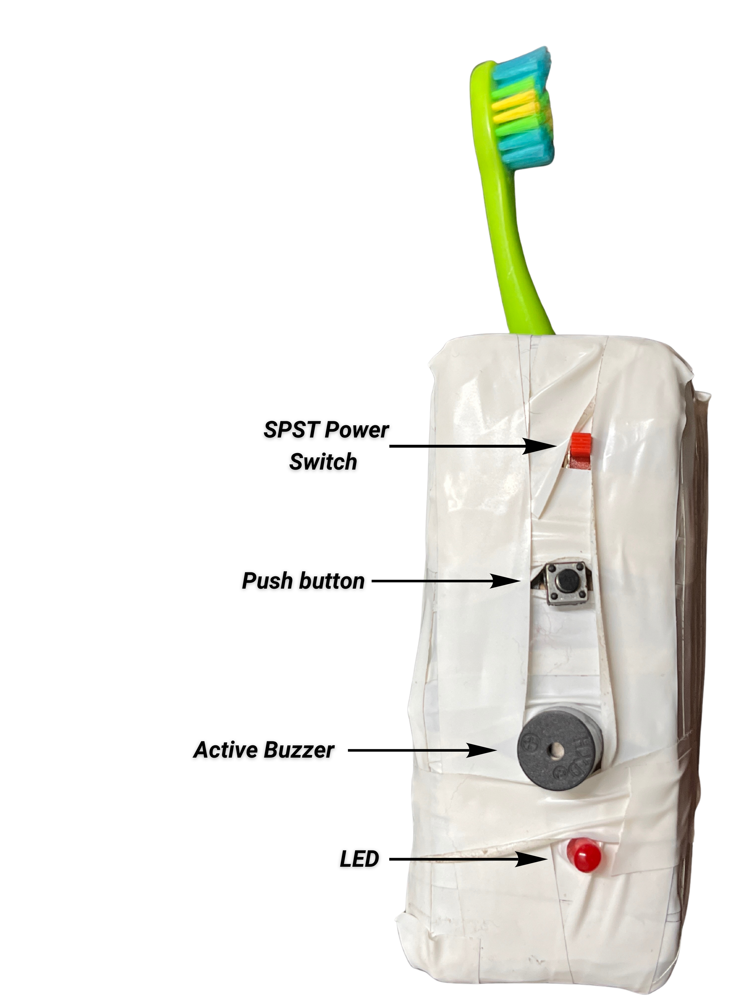
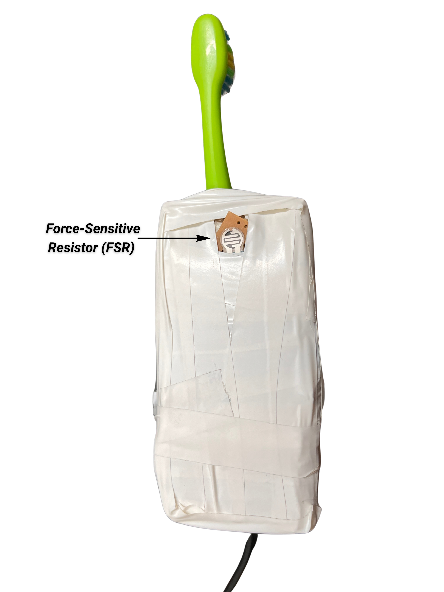
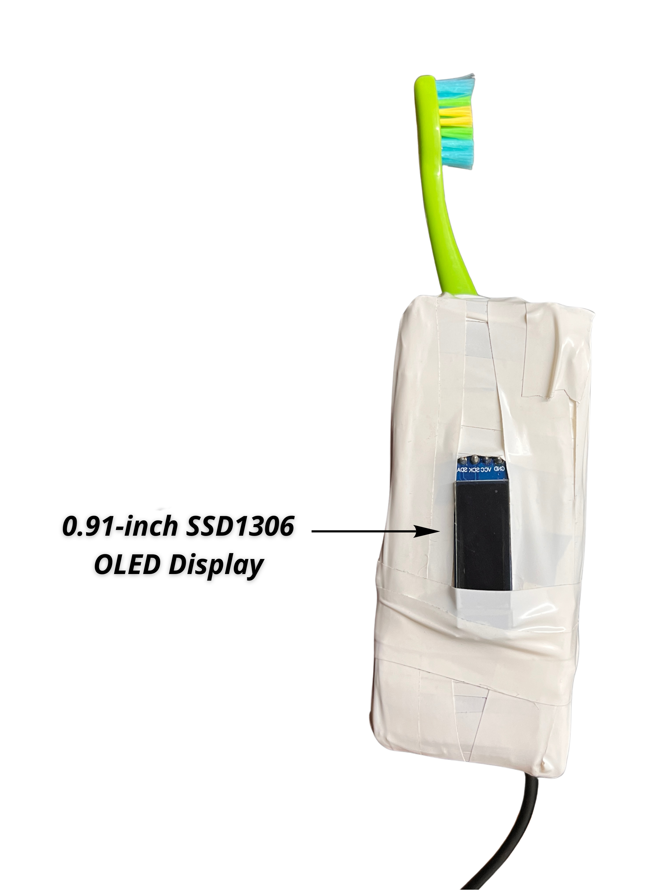
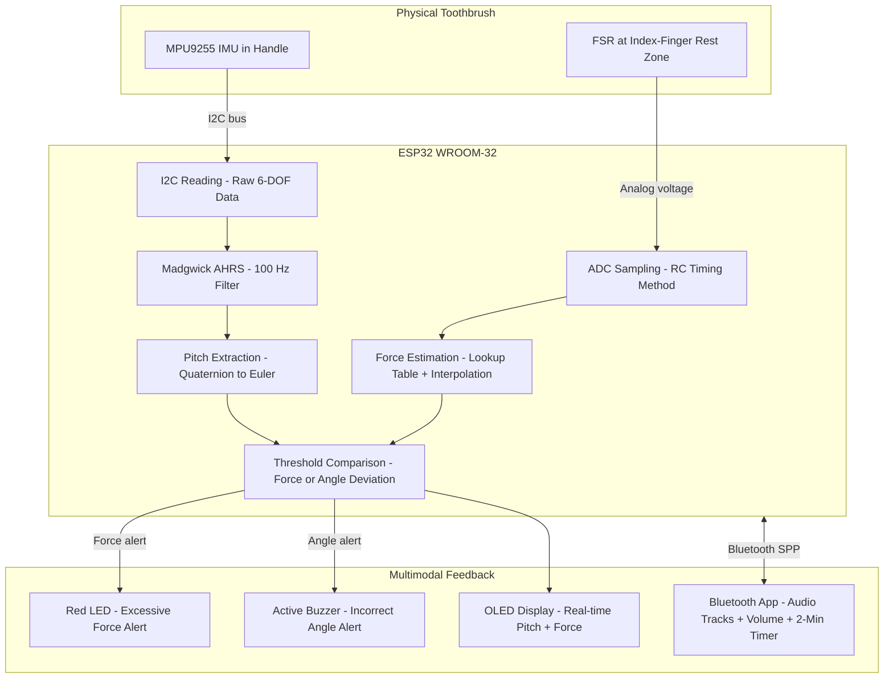

<div align="center">

# 🦷 Pediatric Smart Toothbrush

### *A Real-Time Embedded Brushing Feedback System for Children*

[](https://www.espressif.com/)
[](https://www.arduino.cc/)
[](LICENSE)
[](docs/research_paper.md)
[](patent/)

<br/>

> **An affordable, open-architecture, manual toothbrush platform that provides real-time multimodal feedback on brushing force and orientation — designed specifically for pediatric use.**

<br/>

| 🎯 Target | 👶 Children (ages 5–12) |
|-----------|------------------------|
| 🧠 Core MCU | ESP32 WROOM-32 |
| 📡 Sensing | IMU (MPU9255) + FSR |
| 🔄 AHRS | Madgwick Filter @ 100 Hz |
| ⚡ Force Threshold | 2.0 N (fingertip proxy) |
| 📐 Angle Target | 45° ± 15° (gingival angle) |
| 📱 Companion App | MIT App Inventor (Bluetooth) |
| ⏱ Session Timer | 2 minutes |
| ⏱ System Latency | 68 ms ± 12 ms |
| 📐 Mean Angle Error | 2.3° ± 0.8° |

</div>

---

## 📸 Prototype

<div align="center">

| Front View | FSR Placement | OLED Display |
|:---:|:---:|:---:|
|  |  |  |
| SPST Switch, Push Button, Buzzer, LED | Force-Sensitive Resistor grip zone | 0.91" SSD1306 I²C Display |

</div>

> 📹 **Demo video available** — the 93 MB recording is not hosted in this repository due to GitHub file size limits. Upload it to the [Releases](../../releases) page or YouTube and link here.

---

## 📋 Table of Contents

- [Motivation and Problem Statement](#-motivation--problem-statement)
- [Research Overview](#-research-overview)
- [System Architecture](#-system-architecture)
- [Hardware](#-hardware)
- [Firmware Deep Dive](#-firmware-deep-dive)
- [Sensing Algorithms](#-sensing-algorithms)
- [Experimental Results](#-experimental-results)
- [Repository Structure](#-repository-structure)
- [Getting Started](#-getting-started)
- [Patent Documentation](#-patent-documentation)
- [Authors and Contributors](#-authors--contributors)
- [References](#-references)

---

## 🦷 Motivation and Problem Statement

Dental caries is the **most common chronic disease in children worldwide**, with nearly **500 million children** suffering from untreated tooth decay in their primary teeth. Poor brushing technique — including incorrect brush angle, excessive or insufficient pressure, and insufficient brush duration — is a primary driver.

**The gap between recommended and actual brushing behavior leads to:**
- Plaque buildup → dental caries
- Enamel abrasion from over-brushing
- Gingivitis and long-term periodontal damage
- Pain, missed school days, and reduced quality of life

### Why Existing Solutions Fall Short

| Solution | Problem |
|----------|---------|
| Commercial "smart" electric brushes | Expensive, adult-oriented, proprietary ecosystems |
| Research IMU-based systems | Focus on adult gesture classification, not pediatric real-time correction |
| Vision-based tracking | Requires external camera, not standalone |
| Bristle-level force sensors | Hygiene compromises, incompatible with standard brush heads |

**No prior system** delivers a fully integrated, low-cost toothbrush that simultaneously estimates orientation **and** force, translating both into child-appropriate real-time feedback within a single embedded system.

---

## 📄 Research Overview

> 📖 **Full Paper:** [docs/research_paper.md](docs/research_paper.md)
>
> **Published Title:** *"A Smart Pediatric Toothbrush with Embedded Force and Orientation Sensing for Real-Time Brushing Feedback"*
>
> **Authors:** Sabhyata Soni, Mohammed Talha, Md Sulaiman Qamar, Ishi Soni
>
> **Affiliation:** Department of EEE, UIET, Panjab University, Chandigarh

### Key Contributions

1. **Integrated sensor architecture** for child oral hygiene monitoring — combining IMU-based orientation tracking with FSR-based force proxy sensing in a single embedded device
2. **Calibrated sensing modalities** against children-appropriate thresholds — validated with static loads and precision goniometer angle jigs
3. **End-to-end feedback feasibility** experimentally demonstrated at 68 ms average system latency
4. **Novel indirect force sensing approach** — using fingertip torque on handle as proxy for axial bristle-enamel pressure, avoiding bristle-level instrumentation

---

## 🏗 System Architecture



### Data Flow Timeline

```
Button Press  →  IMU Calibration (1s convergence)  →  Pitch Offset Captured
     |
     v
IMU Loop @ 100 Hz   -->  Madgwick.updateIMU(gx,gy,gz,ax,ay,az)
     |
     v
UI Loop  @ 12.5 Hz  -->  getPitch() - pitchOffset = adjPitch
                    -->  getForceN() via RC timing + lookup table
     |
     v
Threshold Logic     -->  |adjPitch| > 45 +/- 15 deg  -->  BUZZER ON
                    -->  Force > 2.0N                 -->  LED ON
     |
     v
OLED Update         -->  "Pitch: XX.XX | Force: X.XX N"
     |
     v
120s elapsed        -->  dfPlayer.stop()  -->  "Brushing Complete!"
```

---

## 🔧 Hardware

### Bill of Materials

| Component | Part | Role |
|-----------|------|------|
| **Microcontroller** | ESP32 WROOM-32 Dev Board | Central processing, BT, ADC, I2C |
| **IMU** | MPU9255 (GY-9255) | 6-DOF raw accel + gyro data |
| **Force Sensor** | Force-Sensitive Resistor (FSR) | Indirect brushing force proxy |
| **Display** | 0.91" SSD1306 OLED (I2C, 128x32) | Real-time telemetry |
| **Audio** | DFPlayer Mini + speaker | Audio track playback |
| **Buzzer** | Active Buzzer (5V) | Angle misalignment alert |
| **LED** | Red LED | Excessive force alert |
| **Button** | Tactile Push Button | Session start / IMU calibration trigger |
| **Power Switch** | SPST Toggle Switch | Main power control |
| **Capacitor** | 0.1 uF ceramic | FSR RC timing circuit |

### Pin Configuration (ESP32)

| Pin | Function |
|-----|----------|
| GPIO 21 | I2C SDA (MPU9255 + SSD1306) |
| GPIO 22 | I2C SCL (MPU9255 + SSD1306) |
| GPIO 35 | ADC input — FSR RC discharge |
| GPIO 25 | FSR charge pin (RC circuit) |
| GPIO 4 | FSR LED (force indicator) |
| GPIO 14 | Button (session start) |
| GPIO 27 | Active Buzzer (angle alert) |
| GPIO 16 | DFPlayer RX |
| GPIO 17 | DFPlayer TX |
| 0x68 (I2C) | MPU9255 address |
| 0x3C (I2C) | SSD1306 OLED address |

### FSR Sensing Circuit

The FSR uses an innovative **RC timing** method rather than a conventional voltage divider:

```
ESP32 GPIO 25  ---- [FSR] --+-- GPIO 35 (ADC)
                            |
                          [0.1uF]
                            |
                           GND
```

**Operation:**
1. GPIO 25 drives HIGH — charges capacitor through FSR for 2 ms
2. GPIO 25 releases (high-impedance) — capacitor discharges for exactly **901 µs**
3. ADC reads residual voltage — converted via lookup table to force in Newtons

This approach avoids a fixed-value pulldown resistor and allows reliable readings across the highly nonlinear FSR response curve.

---

## 💻 Firmware Deep Dive

> 📁 **Source:** [`firmware/brushFinish/brushFinish.ino`](firmware/brushFinish/brushFinish.ino)

### Libraries Required

Install via Arduino Library Manager:
- `Adafruit SSD1306`
- `Adafruit GFX Library`
- `MadgwickAHRS` (by arduino-libraries)
- `DFRobotDFPlayerMini`

### Key Constants and Thresholds

```cpp
const float FORCE_THRESHOLD_N   = 2.0f;   // Excessive force threshold (Newtons)
const float TARGET_ANGLE        = 45.0;    // Target gingival angle (degrees)
const float ANGLE_TOLERANCE     = 15.0;    // +/-15 degree acceptable window
const unsigned long ANGLE_HOLD_THRESHOLD = 500; // ms before buzzer triggers
const unsigned long brushDuration = 120000;     // 2-minute session (ms)

const unsigned long IMU_INTERVAL_US = 10000; // 100 Hz IMU loop
const unsigned long UI_INTERVAL_MS  = 80;    // 12.5 Hz UI loop
```

### Execution Architecture — Non-Blocking Dual Loop

The firmware uses a non-blocking **dual-frequency architecture** to separate high-frequency sensor fusion from lower-frequency UI updates:

```cpp
void loop() {
  // HIGH FREQUENCY: IMU @ 100 Hz (strictly timed with micros())
  if (mpu_started && (micros() - lastIMUUpdate >= IMU_INTERVAL_US)) {
    filter.updateIMU(gx, gy, gz, ax, ay, az);  // 6-DOF Madgwick update
  }

  // LOW FREQUENCY: UI, Force, Bluetooth @ 12.5 Hz
  if (millis() - lastUIUpdate >= UI_INTERVAL_MS) {
    handleBTCommands();           // Bluetooth volume/track control
    float F = getForceN();        // FSR reading
    float adjPitch = filter.getPitch() - pitchOffset;
    checkBrushingAngle(adjPitch); // Buzzer logic
    // Update OLED with current readings
  }
}
```

### Calibration Sequence

On button press, the system performs a **1-second Madgwick convergence calibration**:

```cpp
// Feed ~200 IMU samples to Madgwick filter for convergence
unsigned long calibStart = millis();
while (millis() - calibStart < 1000) {
    readRawMPU(ax, ay, az, gx, gy, gz);
    filter.updateIMU(gx, gy, gz, ax, ay, az);
    delay(5);
}
pitchOffset = filter.getPitch();  // Capture current angle as zero reference
```

This allows the toothbrush to be calibrated to **any initial holding position** — all subsequent angle readings are relative to this baseline.

### Force Estimation — Piecewise Linear Interpolation

The FSR exponential V-F curve is approximated across 6 calibrated reference points:

```cpp
// Calibrated voltage-to-force mapping
float V_0N   = 3.27f;  // 0g    (0.0N)
float V_0_5N = 2.44f;  // 50g   (0.5N)
float V_1N   = 1.99f;  // 100g  (1.0N)
float V_2N   = 1.65f;  // 200g  (2.0N)  <-- threshold
float V_4N   = 1.14f;  // 400g  (4.0N)
float V_8N   = 0.54f;  // 800g  (8.0N)
```

### Bluetooth Command Protocol

The MIT App Inventor companion app communicates via Classic Bluetooth (SPP):

| Command | Action |
|---------|--------|
| `+` | Volume up (max 30) |
| `-` | Volume down (min 0) |
| `1` to `9` | Play audio track number on DFPlayer Mini |

---

## 🧪 Sensing Algorithms

### 1. Orientation Estimation — Madgwick AHRS

The system uses the **Madgwick Attitude and Heading Reference System** algorithm on 6-DOF IMU data (no magnetometer):

- **Filter rate:** 100 Hz
- **Beta parameter:** 0.1 (balances noise rejection vs. responsiveness)
- **Output:** Internal quaternion → Euler pitch via `filter.getPitch()`
- **Advantage:** Avoids gimbal lock inherent to Euler-only systems

**Angle feedback logic with hysteresis:**
```
adjPitch = filter.getPitch() - pitchOffset

if |adjPitch| is outside [45 +/- 15 degrees]:
    start 500ms hold timer
    if sustained > 500ms: BUZZER ON + OLED "Incorrect Brushing Angle!"
else:
    reset timer, BUZZER OFF
```

### 2. Force Sensing — RC Timing + Lookup Table

Pipeline:
1. GPIO drives HIGH for 2 ms → capacitor charges through FSR
2. GPIO releases HIGH-Z → fixed 901 µs discharge
3. 12-bit ADC reading → voltage = (adc / 4095.0) * 3.3V
4. Piecewise linear interpolation between 6 V-F breakpoints → Force in Newtons
5. Force >= 2.0 N → LED indicator ON

---

## 📊 Experimental Results

### Force Sensor Calibration

Static calibration with known loads applied to the FSR fingertip contact zone:

| Applied Load | Force (N) | Measured Voltage |
|---|---|---|
| 0 g | 0.0 N | ~3.27 V |
| 50 g | 0.5 N | ~2.44 V |
| 100 g | 1.0 N | ~1.99 V |
| 200 g | 2.0 N | ~1.65 V  **<-- Threshold** |
| 400 g | 4.0 N | ~1.14 V |
| 800 g | 8.0 N | ~0.54 V |

**Result:** Consistent threshold detection at 2.0 N setpoint with <8% repeatability error.

### Orientation Tracking Accuracy

Toothbrush fixed at known angles using a precision goniometer jig:

| Metric | Result |
|--------|--------|
| Mean Absolute Angular Error | **2.3° ± 0.8°** |
| Tracking lag (dynamic @ 2 Hz brushing cadence) | < 50 ms |
| Filter convergence time (post-calibration) | ~2 seconds |

> 2.3° mean error is well within the ±15° acceptance window.

### End-to-End System Latency

Measured from sensor event → LED actuation:

| Metric | Result |
|--------|--------|
| Average latency | **68 ms ± 12 ms** |
| Perceptually acceptable threshold | ~100 ms |

> 68 ms is within the perceptually acceptable range for real-time behavioral guidance feedback.

---

## 📁 Repository Structure

```
pediatric-smart-toothbrush/
├── README.md
├── LICENSE
│
├── firmware/
│   └── brushFinish/
│       └── brushFinish.ino         <- Main ESP32 Arduino firmware
│
├── docs/
│   ├── research_paper.md           <- Full research paper (formatted)
│   ├── hardware_setup.md           <- Wiring and assembly guide
│   └── mobile_app.md               <- MIT App Inventor companion app guide
│
├── assets/
│   ├── images/
│   │   ├── prototype_front.png     <- Front view: switch, button, buzzer, LED
│   │   ├── prototype_fsr.png       <- FSR placement (rear/grip zone)
│   │   └── prototype_oled.png      <- OLED display side view
│   └── video/
│       └── demo.mp4                <- Live demonstration recording
│
├── patent/
│   └── design_patent.pdf           <- Design patent documentation
│
└── hardware/
    └── README.md                   <- Component notes and sourcing guide
```

---

## 🚀 Getting Started

### Prerequisites

- [Arduino IDE](https://www.arduino.cc/en/software) (v1.8.x or v2.x)
- ESP32 board support package ([espressif instructions](https://docs.espressif.com/projects/arduino-esp32/en/latest/installing.html))
- Required libraries (Arduino Library Manager):
  - `Adafruit SSD1306`
  - `Adafruit GFX Library`
  - `MadgwickAHRS`
  - `DFRobotDFPlayerMini`

### Hardware Assembly

1. Wire all components per the [Pin Configuration table](#pin-configuration-esp32)
2. Place the FSR **beneath the index-finger grip zone** on the handle
3. Mount MPU9255 **rigidly** in the handle (flex degrades accuracy)
4. Seat the SSD1306 OLED in a visible window on the front
5. Connect DFPlayer Mini to GPIO 16/17 with a small speaker

### Flashing the Firmware

```bash
# Clone the repository
git clone https://github.com/yourusername/pediatric-smart-toothbrush.git

# Open in Arduino IDE
firmware/brushFinish/brushFinish.ino

# Board: ESP32 Dev Module
# Upload Speed: 115200
# Then Upload
```

### First Use — Calibration

1. **Power on** via SPST switch
2. OLED shows: `"Hold normal to teeth / then press button"`
3. **Hold brush at gum-line angle**, then **press the push button**
4. System runs 1-second convergence → OLED: `"Brushing Started!"`
5. Audio track begins playing
6. Brush for **2 minutes** with real-time feedback
7. Session auto-completes → OLED: `"Brushing Complete!"`

### Companion App

Pair with Bluetooth device name: **`SmartBrush`**

The MIT App Inventor app allows caregivers to:
- Select audio tracks (`1`–`9` sent over BT)
- Adjust volume (`+` / `-`)
- Monitor the 2-minute session timer

---

## 🏛 Patent Documentation

This project is accompanied by design patent documentation covering the physical design and form factor of the embedded sensing handle.

> 📄 **[View Design Patent Documentation](patent/design_patent.pdf)**

---

## 📚 Discussion and Limitations

### Engineering Tradeoff: FSR vs. Load Cell

| Aspect | FSR (This Work) | Neck Load Cell |
|--------|-----------------|----------------|
| Cost | Very low | Moderate to high |
| Hygiene | Handle only, no bristle contact | Risk of contamination |
| Brush head compatibility | Any standard brush | Specific to design |
| Measurement type | Proxy (fingertip torque) | Direct (axial force) |
| Child-safety suitability | Yes | Marginal |

### Current Limitations

1. **No pediatric user study** — Validated in lab only, no child participants
2. **No oral quadrant localization** — Cannot detect which mouth section is brushed
3. **Grip sensitivity** — FSR readings vary slightly with finger placement
4. **Bluetooth audio latency** — Not precisely characterized

### Future Directions

- Pediatric user study (ages 5–12) for behavioral outcome measurement
- Magnetometer-assisted spatial localization for quadrant detection
- Miniaturization into a production-quality handle
- Wireless charging integration
- Long-term field deployment study

---

## 👥 Authors and Contributors

| Name | Role | Institution |
|------|------|-------------|
| **Sabhyata Soni** | Co-Author | Dept. of EEE, UIET, Panjab University, Chandigarh |
| **Mohammed Talha** | Co-Author | Dept. of EEE, UIET, Panjab University, Chandigarh |
| **Md Sulaiman Qamar** | Co-Author | Dept. of EEE, UIET, Panjab University, Chandigarh |
| **Ishi Soni** | Co-Author | Dept. of EEE, UIET, Panjab University, Chandigarh |

---

## 📖 References

1. Q. Yang et al., "OpenBrush: An open-source manual toothbrush for force and motion sensing," *Proc. UbiComp Companion*, 2025.
2. D. Jacobson et al., "Evaluating child toothbrushing behavior changes associated with a mobile game app," *Pediatr. Dent.*, vol. 41, no. 4, 2019.
3. N. Fraihat et al., "Clinical effectiveness and cost-effectiveness of oral-health promotion in dental caries prevention among children," *Int. J. Environ. Res. Public Health*, vol. 16, no. 15, 2019.
4. S. O. H. Madgwick, A. J. L. Harrison, and R. Vaidyanathan, "Estimation of IMU and MARG orientation using a gradient descent algorithm," *Proc. IEEE Int. Conf. Rehabil. Robot.*, 2011.
5. M. Akhtaruzzaman, "Force-sensitive classic toothbrush: System analysis, design, and simulation," *Electrica*, vol. 21, no. 2, 2021.
6. H. Li and L. Jing, "3D Monitoring of Toothbrushing Regions and Force Using Multimodal Sensors and Unity," *IEEE Access*, vol. 11, 2023.

> 📖 Full reference list in [docs/research_paper.md](docs/research_paper.md#references)

---

## 📜 License

This project is released under the [MIT License](LICENSE). Design patent documentation is proprietary.

---

<div align="center">

**Star this repository if you find it useful!**

*Built at the Department of EEE, UIET, Panjab University, Chandigarh*

</div>

